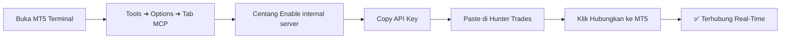

# 📖 Panduan Pengguna: Install & Menghubungkan MetaTrader 5

> **Hunter Trades Journal & AI Trading Engine**
> Panduan resmi untuk user: install aplikasi desktop, verifikasi semua service jalan, lalu
> menghubungkan MetaTrader 5 (MT5) via protokol **Native Model Context Protocol (MCP)**.

---

## 🖥️ Bagian 1 — Install EXE Production

### Yang Anda butuhkan

| Kebutuhan | Keterangan |
|---|---|
| **Windows 10/11 (64-bit)** | Aplikasi desktop hanya tersedia untuk Windows. |
| **RAM** | Minimal 4 GB. Di bawah itu aplikasi tetap jalan tapi AI dan backtest lebih lambat (aplikasi akan menampilkan peringatan). |
| **MetaTrader 5** | Build terbaru yang punya tab **MCP** di menu Options. Boleh di-install setelahnya. |
| **Akun MongoDB** | Koneksi ke database. Bisa lokal maupun MongoDB Atlas — diisi saat first-run setup. |

### Langkah install

1. **Unduh installer** `Hunter Trades Setup <versi>.exe` dari halaman GitHub Releases.
2. **Jalankan installer.** Klik **Next**, pilih folder instalasi, lalu **Install**.
   Installer akan membuat shortcut di Desktop dan Start Menu.
3. **Jalankan first-run setup** — saat pertama kali dibuka, aplikasi mendeteksi bahwa
   `server.env` belum ada dan menampilkan jendela **Setup Configuration**. Isi semua field
   bertanda bintang (wajib):

   | Field | Keterangan |
   |---|---|
   | **Database URL** \* | Connection string MongoDB — Atlas (`mongodb+srv://...`) atau lokal. |
   | **Auth Secret** \* | String acak minimal 32 karakter. Generate: `openssl rand -base64 32`. |
   | **Encryption Key** \* | String acak minimal 32 karakter. Dipakai enkripsi kredensial MT5. |
   | **Discord Client ID** \* | Dari Discord Developer Portal. |
   | **Discord Client Secret** \* | Dari Discord Developer Portal. |
   | **Discord Guild ID** \* | ID server Discord untuk verifikasi keanggotaan. |
   | **Midtrans Server Key** \* | Dari dashboard.midtrans.com → Settings → Access Keys. |
   | **Midtrans Environment** \* | `Sandbox` (testing) atau `Production`. |

   Field opsional: **9Router URL** dan **9Router API Key** — biarkan default
   (`http://127.0.0.1:20128/v1`) kalau Anda tidak memakai gateway LLM sendiri.

   Aplikasi akan menolak menyimpan kalau ada field wajib yang kosong, dan menyebutkan nama
   field yang bermasalah.

4. **Klik Simpan.** Konfigurasi ditulis ke `%APPDATA%\hunter-trades-desktop\server.env`
   dan dipakai backend pada setiap start berikutnya. Setup ini hanya muncul sekali — untuk
   mengubahnya nanti, edit file tersebut lalu restart aplikasi.
5. **Tunggu splash screen selesai** (10–60 detik saat pertama kali). Setelah itu jendela
   utama Hunter Trades terbuka.

> Aplikasi berjalan di **system tray**. Menutup jendela tidak mematikan service — klik kanan
> icon tray lalu **Quit** untuk menghentikan semuanya.

### Verifikasi semua service jalan

Buka Command Prompt / PowerShell dan jalankan:

```bash
curl http://localhost:5000/health    # -> {"status":"OK","timestamp":"..."}
curl http://localhost:3000           # -> halaman Hunter Trades
curl http://localhost:20128          # -> 9Router gateway aktif
curl http://127.0.0.1:22346/mcp      # -> MT5 MCP (butuh MT5 terbuka)
```

| Port | Service | Kalau gagal |
|---|---|---|
| `3000` | Frontend (UI) | Cek `logs\frontend.log`. Sering karena port dipakai proses lain. |
| `5000` | Backend API | Cek `logs\backend.log` — biasanya ada variabel `.env` yang belum diisi. |
| `20128` | 9Router (LLM gateway) | Cek `logs\9router.log`. Tanpa ini, fitur AI tidak jalan. |
| `22346` | MT5 Native MCP | Milik MetaTrader 5 — pastikan MT5 terbuka (lihat Bagian 2). |

**Lokasi log:** `%APPDATA%\hunter-trades-desktop\logs\`
(`main.log`, `backend.log`, `frontend.log`, `9router.log`)

### Update otomatis (OTA)

Aplikasi memeriksa pembaruan 10 detik setelah start, lalu setiap 1 jam. Kalau ada versi baru,
aplikasi menampilkan dialog — klik **Update** untuk mengunduh dan menerapkan patch.

Patch diverifikasi checksum SHA-256 sebelum dipasang. Kalau penerapan gagal, aplikasi
**otomatis kembali ke versi sebelumnya** supaya tetap bisa dipakai. Versi lokal yang lebih
baru tidak akan pernah diturunkan (downgrade) oleh server.

### Troubleshooting install

| Gejala | Solusi |
|---|---|
| Splash tidak hilang, muncul "Failed to start servers" | Port 3000/5000 sedang dipakai. Tutup aplikasi lain yang memakai port tersebut, lalu buka Hunter Trades lagi. |
| "Backend crash" saat start | Ada variabel wajib yang kosong. Cek `logs\backend.log` — nama variabelnya disebutkan. |
| Halaman putih / blank | Tutup aplikasi, lalu pasang ulang installer. Kalau masih terjadi, hubungi support. |
| Aplikasi tidak muncul setelah diklik | Cek system tray — jendela mungkin sedang diminimize ke tray. Klik dua kali icon tray. |
| Aplikasi terasa lambat | Tutup aplikasi berat lain. AI dan backtest butuh RAM; sistem dengan < 4 GB akan lebih lambat. |

---

## 🔌 Bagian 2 — Menghubungkan MetaTrader 5

### 💡 Konsep & Solusi Arsitektur Multi-User

Setiap pengguna Hunter Trades memiliki terminal **MetaTrader 5** dan akun broker tersendiri. Pada versi terbaru:
1. **Tidak Membutuhkan Python Server / Aplikasi Tambahan**: MT5 modern kini telah dilengkapi **Native MCP Server** internal resmi dari MetaQuotes.
2. **API Key Masing-Masing User**: Setiap terminal MT5 menghasilkan **API Key unik** yang bertindak sebagai token otentikasi lokal yang aman.
3. **Privasi & Keamanan Maksimal**: Anda **tidak perlu menginput password broker** Anda ke Hunter Trades. Hunter Trades berkomunikasi langsung dengan MT5 lokal melalui API Key.

---

## 🚀 Langkah-Langkah Menghubungkan MT5 (Langkah Demi Langkah)



### Langkah 1: Buka MetaTrader 5
1. Buka aplikasi **MetaTrader 5** di PC / Laptop / VPS Windows Anda.
2. Pastikan Anda sudah login ke akun trading Anda (Demo ataupun Real).

### Langkah 2: Buka Pengaturan MCP
1. Pada menu bar bagian atas MT5, klik **Tools** ➜ **Options** (atau gunakan shortcut keyboard <kbd>Ctrl + O</kbd>).
2. Di jendela Options, klik tab **MCP** di bagian paling kanan.

### Langkah 3: Aktifkan Internal Server & Dapatkan API Key
1. Centang kotak **"Enable internal server"**.
2. Perhatikan kolom **API Key**:
   - Jika kolom sudah terisi string acak (misal: `1oBaWtEsZuqVsfzLoHlALKBt...`), klik tombol **Copy** di sampingnya.
   - Jika kolom masih kosong, klik tombol **Generate**, lalu klik **Copy**.
3. Pastikan kolom **Server address** berada pada default: `http://127.0.0.1:22346` (atau `22346`).
4. Klik tombol **OK** untuk menyimpan konfigurasi di MT5.

### Langkah 4: Hubungkan di Hunter Trades
1. Buka aplikasi Hunter Trades (versi Desktop atau Web Dashboard).
2. Masuk ke menu **AI Trading** (atau menu **Settings ➜ Integrations ➜ MetaTrader**).
3. Tempelkan (**Paste**) API Key yang sudah Anda salin ke form **MT5 MCP API Key**.
4. Klik tombol **Hubungkan ke MT5** (atau **Establish Connection**).

Dalam 1–2 detik, Hunter Trades akan langsung menampilkan:
- ✅ Status: **Connected**
- 💰 **Account Balance & Equity**
- 📊 **Open Positions & History**
- 🤖 **AI Trading Execution & Signal Engine siap aktif**

---

## ⚙️ Opsi Lanjutan (Advanced Configuration)

Jika Anda menjalankan MT5 di port custom atau remote port:
- Buka dropdown **"Opsi Lanjutan (Address & Port)"** pada form koneksi.
- Masukkan URL MCP Anda (contoh: `http://127.0.0.1:22346/mcp`).

---

## ❓ Troubleshooting & Tanya Jawab (FAQ)

### 1. Mengapa tab "MCP" tidak muncul di menu Options MT5 saya?
* **Penyebab**: Versi MetaTrader 5 Anda belum mendukung fitur Native MCP (butuh MT5 build terbaru).
* **Solusi**: 
  - Di MT5, klik menu **Help** ➜ **Check for Updates** ➜ **Latest Beta/Release Version**.
  - Atau unduh installer MT5 terbaru dari broker Anda / situs resmi MetaQuotes.

### 2. Error: "Connection failed" / "Failed to connect to MT5"
* **Penyebab**: 
  - Terminal MT5 belum dibuka / ditutup saat menekan tombol hubungkan.
  - Opsi *Enable internal server* belum dicentang di MT5.
  - Firewall Windows memblokir port internal 22346.
* **Solusi**:
  1. Pastikan MT5 tetap terbuka di latar belakang.
  2. Buka *Tools ➜ Options ➜ MCP*, pastikan *Enable internal server* sudah dicentang dan klik *OK*.
  3. Coba klik kembali *Hubungkan ke MT5*.

### 3. Apakah API Key saya aman?
* **Ya, 100% Aman**: API Key hanya bekerja untuk komunikasi lokal antara Hunter Trades dan MT5 di PC Anda (`127.0.0.1`). Password akun broker Anda tidak pernah dibagikan atau disimpan dalam bentuk plaintext.

---

## 📞 Bantuan Tambahan
Jika Anda mengalami kendala saat install aplikasi atau menghubungkan akun Anda, silakan
hubungi tim support Hunter Trades melalui komunitas Discord resmi kami.

Saat melapor, sertakan:
- Versi aplikasi (terlihat di splash screen atau menu Settings → About)
- Isi file log yang relevan dari `%APPDATA%\hunter-trades-desktop\logs\`
- Hasil perintah `curl http://localhost:5000/health`

> ⚠️ **Jangan pernah mengirimkan API Key MT5, password broker, atau isi file `.env` Anda
> kepada siapa pun** — termasuk ke tim support. Semua kredensial bersifat pribadi.
